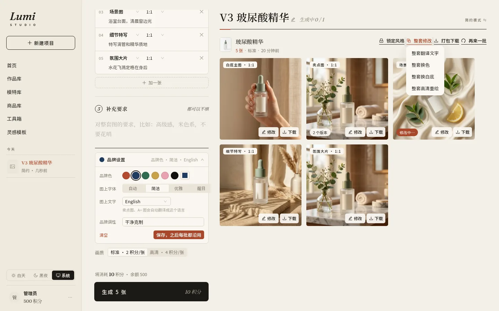
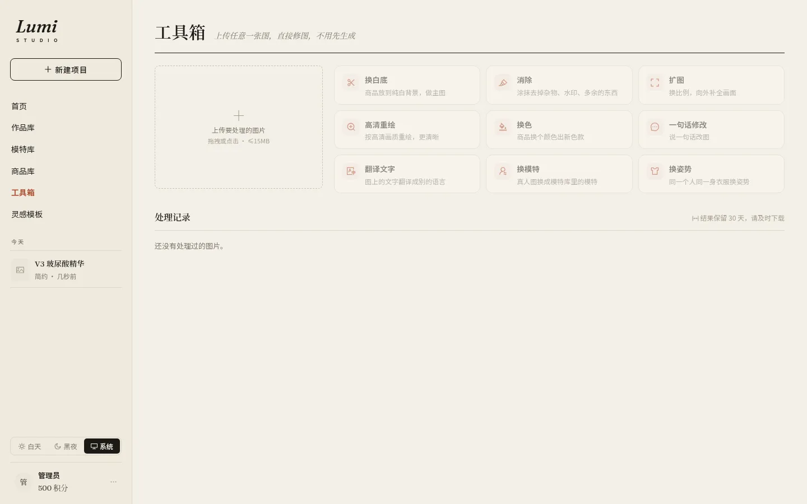

<div align="center">

# Lumi Studio

**一张商品图，出一整套上架图。**

面向电商卖家的 AI 生图 SaaS：上传商品，选好要哪几张图，主图、场景、模特、卖点、详情一次出齐，商品外观不走样。用户不用写提示词，也不用挑模型。


</div>

---

## 预览

| 三步工作台 | 灵感模板 |
|---|---|
|  |  |
| **大图查看 · 版本对比** | **图层编辑器** |
|  |  |
| **工具箱** | **移动端** |
|  |  |

> 截图均为本地演示数据，不含真实用户信息。

## 功能

### 出图
- **三步工作台**：上传商品 → 选套餐或逐张定类型与比例（白底主图、场景、模特上身、卖点、细节特写、氛围大片等）→ 补一句要求，生成。
- **AI 看图写卖点和分镜**：识别商品后自动给出卖点与每张图的分镜，可逐条修改。
- **简约 / 详细两种模式**：单商品；或主商品 + 两件搭配，模特穿搭完整、不加没上传的可售单品。
- **灵感模板**：42 个模板（16 个精选），上传自己的商品「做同款」，可复刻参考图构图或只学光线色调。
- **AI 模特库**：生成并保存定妆照，跨批次复用同一模特；支持换模特、换姿势。
- **品牌设置**：品牌色、图上字体、调性与图上文字语言，外语自动翻译，之后每批沿用。
- **商品库**：保存常用商品与卖点，多选批量出图。

### 商品保真
- **本地抠图**：内置 IS-Net（ONNX，CPU 运行），白底与透明底不再让模型重画商品。
- **原商品像素贴回**：生成后识别商品轮廓，形状和边缘都对得上（IoU ≥ 0.95）才贴回原图像素并迁移光照；对不上就保留生成结果，不硬贴。
- **自动质检**：出图后检查商品一致性与画面问题，不通过免费重出一次。

### 编辑
- **图层编辑器**（Konva）：文字、色块、商品抠图层、Logo/图片层；拖动缩放旋转、对齐辅助线、撤销重做、5 种中文字体、描边/投影/字距。保存为新版本，设计稿可反复打开继续改。
- **一句话修改**、画笔消除、扩图、换白底、高清重绘、换色、翻译图上文字；可对整套一次修改。
- **版本归组**：每次重试或修改都挂在原图下，大图查看器左右切换、原图对比。
- **导出**：按淘宝天猫、京东、拼多多、抖店、小红书、亚马逊等平台尺寸打包 ZIP，或拼成详情长图。

### 运营后台
- 用户、邀请码、积分流水、任务与单图记录、审计日志。
- 上游渠道与模型路由（生图 / 规划对话分开配置），失败自动换渠道兜底，失败全额退积分。
- 定价后台可调：任务创建时快照单价，退款按快照；定价页显示各模型毛利预估。
- 模板管理、并发限额、告警 Webhook。

## 技术栈

| 层 | 选型 |
|---|---|
| 前端 | React 19 · Vite · Ant Design 5 · React Router 7 · Konva |
| 后端 | Node.js · Fastify 5 · TypeScript · Zod |
| 数据 | PostgreSQL 17 · Redis 7 · BullMQ |
| 图像 | sharp · onnxruntime-node（IS-Net 抠图） |
| 部署 | Docker Compose · Caddy（自动 HTTPS） |

```
          ┌──────────── Caddy（HTTPS / 静态前端）────────────┐
浏览器 ──▶ │  /           → React SPA                         │
          │  /api /files → api (Fastify)                     │
          └───────────────┬──────────────────────────────────┘
                          │ 入队
              PostgreSQL ◀┼▶ Redis / BullMQ ──▶ worker（规划 → 生图 → 贴回 → 质检）
                          │                        │
                         cron（30 天清理、告警）     └──▶ 上游生图 / 对话渠道
```

## 快速开始（本地开发）

需要 Node.js 22+、PostgreSQL、Redis。

```bash
npm ci
cp .env.example server/.env        # 填 DATABASE_URL / REDIS_URL / APP_SECRET / MASTER_KEY

npm run dev    -w server   # API :8787，启动时自动迁移并创建管理员
npm run worker -w server   # 出图队列
npm run cron   -w server   # 过期清理 + 告警
npm run dev    -w web      # 前端 :5173，/api 与 /files 代理到 :8787
```

首次登录管理后台后，在「渠道」里填入上游 API 地址和 Key（只写不读，AES-256-GCM 加密入库），再到「路由」里分配模型。

抠图模型不在仓库里：Docker 构建时会自动下载并校验；本地开发如需抠图，下载 `isnet-general-use.onnx` 并用环境变量 `MATTING_MODEL` 指向它（来源与校验值见 `Dockerfile` 与 [THIRD_PARTY_NOTICES.md](THIRD_PARTY_NOTICES.md)）。

## 生产部署

```bash
cp .env.example .env && chmod 600 .env   # 填 DOMAIN / PUBLIC_ORIGIN / POSTGRES_PASSWORD / APP_SECRET / MASTER_KEY
docker compose up -d --build
```

只有 Caddy 对外暴露 80/443。完整手册（备份恢复、R2 存储、告警、PaaS 部署）见 **[deploy/README-deploy.md](deploy/README-deploy.md)**。

> ⚠️ `MASTER_KEY` 务必离线备份：丢失后数据库里保存的上游 Key 将全部无法解密。

| 文件 | 作用 |
|---|---|
| `Dockerfile` | 多阶段构建：`runtime`（api / worker / cron，非 root）、`caddy`（Caddy + 前端静态包） |
| `docker-compose.yml` | postgres、redis、api、worker、cron、caddy |
| `deploy/Caddyfile` | 自动 HTTPS、安全头、20MB 上限、SPA 回退、反代 |
| `deploy/backup.sh` · `restore.sh` | 每日 pg_dump，可选 age 加密 + rclone 异地；恢复演练 |
| `.env.example` | 全部环境变量说明 |

## 安全设计

- 密码 argon2id；会话 token 只存 SHA-256；Cookie `SameSite=Strict` + `HttpOnly`。
- 写接口校验 Origin 与自定义请求头，全接口 Zod 校验与限流。
- 上传图片经 sharp 重新编码，去除元数据与恶意载荷；文件 URL 带签名并过期。
- 所有资源按用户隔离，跨用户访问、越权素材均有回归测试。
- 上游请求做 SSRF 防护；图上文字过滤网址、联系方式和引流文案。
- 用户上传与生成图默认保留 30 天后自动清理。

安全回归：`server/test/security.sh`。

## 目录结构

```
server/
  src/
    index.ts  worker.ts  cron.ts       # 三个进程入口
    routes/                            # auth · work · design · extras · library · admin
    services/                          # planner · prompt · routing · matting · pasteback · credits · pricing
    templates/                         # 场景模板
    db/migrations/                     # 001–010
  seed/templates-v2/                   # 灵感模板种子与样图
  test/                                # security.sh · e2e.sh · setup-dev.sh
web/
  src/pages/                           # Landing · Home · Workbench · Templates · Gallery · Products · Tools · admin
  src/components/                      # Composer · Viewer · DesignEditor · EditModal · ExportMenu …
deploy/                                # Caddyfile · 备份恢复 · 部署手册
docs/                                  # api.md · 截图
```

接口文档：[docs/api.md](docs/api.md)。

## 第三方组件

IS-Net 抠图模型等第三方组件的来源与许可见 [THIRD_PARTY_NOTICES.md](THIRD_PARTY_NOTICES.md)。
